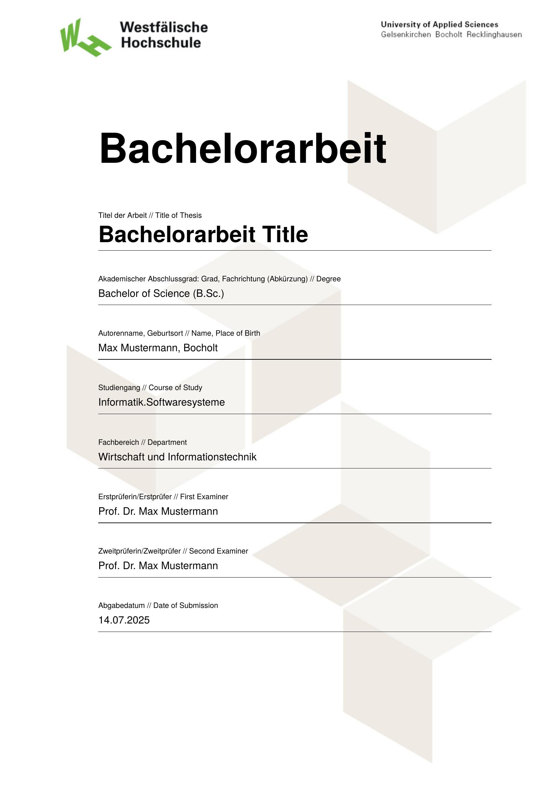

# WHS Thesis Template



This **unofficial** template can be used to write in [Typst](https://github.com/typst/typst) with the corporate design of the [Westfälische Hochschule](https://www.w-hs.de/).

#### Disclaimer

Please ask your supervisor if you are allowed to use typst and this template for your thesis or other documents.
Note that this template is not checked by the Westfälische Hochschule for correctness.
Thus, this template does not guarantee completeness or correctness.

## Usage

Create a new typst project based on this template locally.
```bash
typst init @preview/modern-whs-thesis
cd modern-whs-thesis
```

Or create a project on the typst web app based on this template.

## Configuration

The package can be configured where it is initialized. All parameters are named and optional, so you only need to pass the ones you want to change. The example project keeps its values in the `meta.typ` file.

```typst
#show: whs-thesis.with(
  title: meta.title,
  title-size: meta.title-size,
  thesis-type: meta.thesis-type,
  author: meta.author,
  first-name: meta.first-name,
  last-name: meta.last-name,
  date: meta.date,
  date-of-submission: meta.date-of-submission,
  place-location: meta.place-location,
  place-birth: meta.place-birth,
  keywords: meta.keywords,
  degree: meta.degree,
  study-course: meta.study-course,
  department: meta.department,
  first-examiner: meta.first-examiner,
  second-examiner: meta.second-examiner,
  signature: image("images/signature.png", height: 75pt), // none to disable
  abstract: [#abstract], // none to disable
  appendix: [#appendix], // none to disable
  bibliography: meta.bibliography, // none to disable
  acronyms: acronyms.acronyms, // none to disable
  language: meta.language, // "de" or "en"
  citation-style: meta.citation-style, // e.g. "ieee", "apa", "chicago"
  background: "default", // "default", "gray", or a custom image()
  font: "TeX Gyre Heros",
  math-font: "New Computer Modern Math",
  raw-font: "Fira Code",
)
```

## Customizing this template

If the predefined design of this template doesnt fit your needs, you can customize it by following these steps:

1. Download the repository of this template
2. Copy the template folder `/templates/thesis/template` into your project.
3. Replace the import of `@preview/modern-whs-thesis` with `template/lib.typ`
